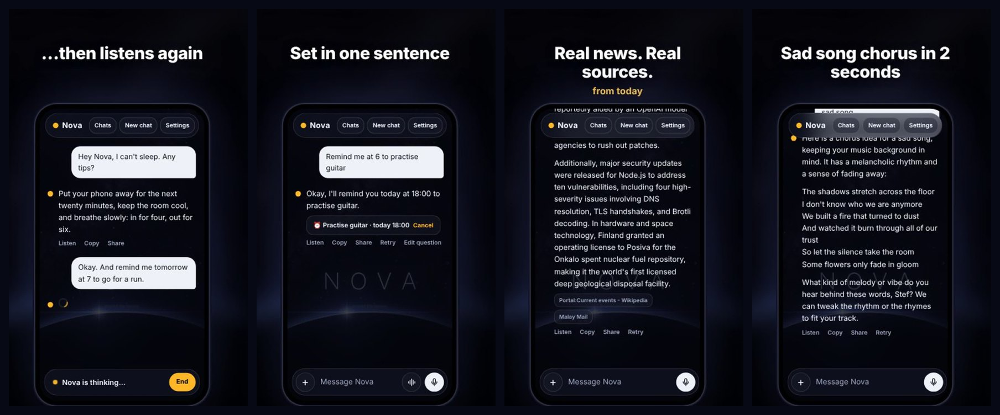

# Nova – a free AI assistant you can talk to

**Nova** is a free AI assistant for **Android, Windows, iPhone and the web**. Talk to it out loud and it answers with a natural voice, in **English or Romanian**.

**→ Download: [stefputamica-ctrl.github.io/nova-ai](https://stefputamica-ctrl.github.io/nova-ai/)** · [Pagina în română](https://stefputamica-ctrl.github.io/nova-ai/ro/) · [Open the web app](https://stefputamica-ctrl.github.io/nova-ai/app/)

## What it does

- 🎙️ **Conversation mode.** Talk hands-free like a phone call. Nova answers out loud, then listens again.
- ⏰ **Reminders.** Say "remind me at 6 to practise guitar" and your phone pings you on time, even with Nova closed.
- 🔎 **Web search with sources.** Today's news, prices and scores, with the links right under the answer.
- 🧠 **Memory.** Nova remembers your name and what you like, chat after chat. You can see and delete every note.
- 🖼️ **Photos, PDFs and text files.** Ask what's in a picture, or get a summary of a PDF.
- 🎨 **Makes pictures.** Ask for a drawing, then save it or set it as your wallpaper.
- 📄 **Word, Excel and PDF files.** "Turn this into a Word document" or "make my budget into an Excel table", and Nova makes the file. Save any chat as Word, PDF or text.
- ☀️ **Morning brief.** Weather, top news and your reminders for the day, every morning.
- 📁 **Chat folders**, synced between devices.
- 💻 **Code help.** Code arrives in its own box with a copy button.
- 🔗 **Opens apps and sites.** Say "play lofi on YouTube" and it opens YouTube.
- 📲 **Share into Nova** from any Android app: links, text, photos and PDFs.
- ☁️ **Sync.** Log in and your chats, memory and settings follow you between phone, PC and web.
- 🇷🇴 **English and Română.** Nova answers in your language and reads it with a matching voice.

## Get it

| Device | How |
|---|---|
| **Android** | [Download the APK](https://stefputamica-ctrl.github.io/nova-ai/#download), open it and tap Install |
| **Windows** | [Download the installer](https://stefputamica-ctrl.github.io/nova-ai/#download). If Windows warns you, click *More info → Run anyway* |
| **iPhone** | Open the [web app](https://stefputamica-ctrl.github.io/nova-ai/app/) in Safari → Share → *Add to Home Screen* |
| **Web** | [Open Nova in your browser](https://stefputamica-ctrl.github.io/nova-ai/app/) |

Nova uses your own **free Google Gemini key** (get one at [aistudio.google.com](https://aistudio.google.com) → *Get API key*). The key stays on your device and is never sent to us.

## Privacy

No ads and no tracking. Chats stay on your device unless you turn on sync. Read the [privacy policy](https://stefputamica-ctrl.github.io/nova-ai/privacy.html).

---

Made by a hobbyist in Romania. Answers come from Google Gemini and can be wrong. Pictures are made by [Pollinations.ai](https://pollinations.ai).
